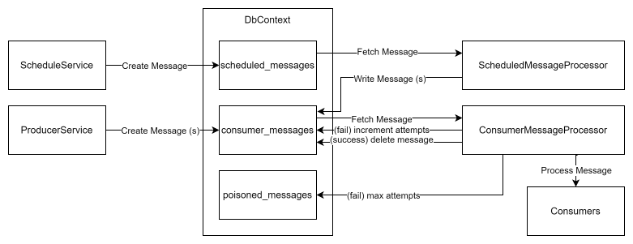

## ProducerService

Resolves consumers for a given payload and writes messages to the `consumer_messages` table for processing.

## ScheduleService

Writes scheduled messages to the `scheduled_messages` table.

## Tables

`ConfigureAsyncMonolith()` maps three tables (with an optional schema and table prefix):

- `consumer_messages`: one row per pending message per consumer.
- `scheduled_messages`: recurring schedules and when they are next due.
- `poisoned_messages`: messages that failed every attempt, with the last error.

## ConsumerMessageProcessor

One background processor runs per rail. Each cycle it:

1. **Claims** a batch in a short transaction: it reads due messages (locking rows on PostgreSQL, SQL Server, MySQL and MariaDB), then for each one counts the attempt and leases it by moving `available_after` past the consumer's timeout plus 30 seconds. The update only applies if the message is unchanged since it was read, so only one processor can claim it.
2. **Consumes** each claimed message outside any transaction, in its own DI scope, so consumers can use the database freely.
3. **Completes** each message in its own short write: deleted on success, otherwise retried after a backoff delay, or moved to `poisoned_messages` after its last attempt. If its lease was taken over meanwhile, nothing is changed.

If the app stops mid-message, the message becomes available again when its lease expires.

## ScheduledMessageProcessor

Reads due schedules and, for each one, moves it to its next occurrence (conditionally, so each occurrence fires once across instances) and produces a message for every consumer of its payload. A schedule that can't be evaluated is checked again an hour later without affecting the others. It also deletes expired poisoned messages when `PoisonedMessageRetention` is set.

## Notes 📋

- After a batch that wasn't full a processor waits `IdlePollInterval`; after a full batch it waits `BusyPollInterval`. While batches keep failing (for example during a database outage) the wait doubles up to 30 seconds.
- Consumers and payloads are found by scanning the registered assemblies at startup, and the registry is checked for name clashes and payloads without consumers when the host starts.
